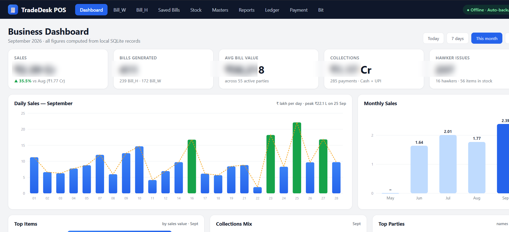
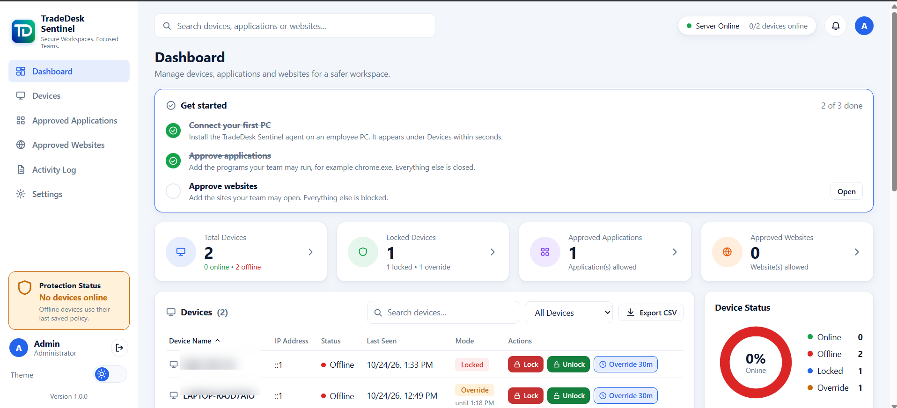

# Client Projects Portfolio

Selected business software projects covering POS/ERP workflows, backend engineering and Windows workspace control.

This repository contains **sanitized case studies, product screenshots and architecture notes only**. It does not contain client source code, customer records, production credentials, databases, license material or deployment secrets.

## Featured work

### TradeDesk POS

Desktop business software for wholesale and hawker billing, inventory, reports, ledger and payment workflows.

[View TradeDesk POS case study](case-studies/tradedesk-pos.md)

### TradeDesk Sentinel

Windows workspace administration interface for device status, lock controls, approved applications and websites, and activity monitoring.

[View TradeDesk Sentinel case study](case-studies/tradedesk-sentinel.md)

## Case studies

| Project | Focus | Technologies |
|---|---|---|
| [TradeDesk POS](case-studies/tradedesk-pos.md) | Wholesale/hawker billing, inventory, reporting and desktop workflows | Node.js, Express, JavaScript, SQLite, Electron |
| [Pharmacy ERP API](case-studies/pharmacy-erp-api.md) | Multi-tenant ERP backend, billing, inventory, GST data and prescriptions | Node.js, Express, TypeScript, PostgreSQL, Drizzle ORM |
| [TradeDesk Sentinel](case-studies/tradedesk-sentinel.md) | Windows device administration, application/site allowlists and activity monitoring | Node.js agent/server, SQLite, Windows integration |

## Architecture

- [Pharmacy ERP API architecture](architecture/pharmacy-erp-api.mmd)
- [TradeDesk POS architecture](architecture/tradedesk-pos.mmd)
- [TradeDesk Sentinel architecture](architecture/tradedesk-sentinel.mmd)

## Evidence and accuracy

The screenshots illustrate product interfaces and workflows; they are not independent proof of production deployment, live endpoint enforcement, customer outcomes or business performance. See each case study's **Verification boundaries** section for known limitations.

No public performance, uptime, customer-count or revenue claims are made here.

## Contact

- GitHub: [rishabh-kori-05](https://github.com/rishabh-kori-05)
- LinkedIn: [LinkedIn Profile](https://www.linkedin.com/in/rishabh-kori-2bb172391/)

## Confidentiality

Screenshots in this repository are intended to omit or obscure sensitive information. If you spot any customer, supplier, device, network, financial or authentication detail that should not be public, please flag it so it can be removed.
