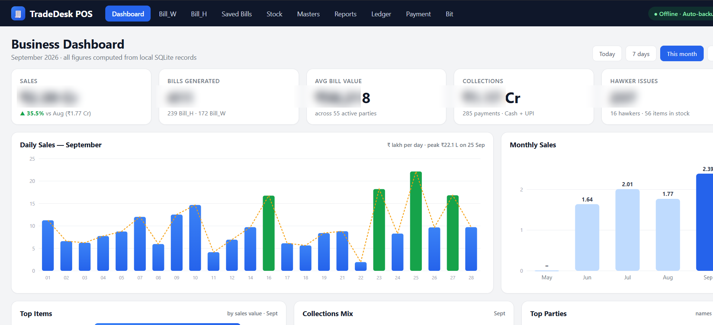
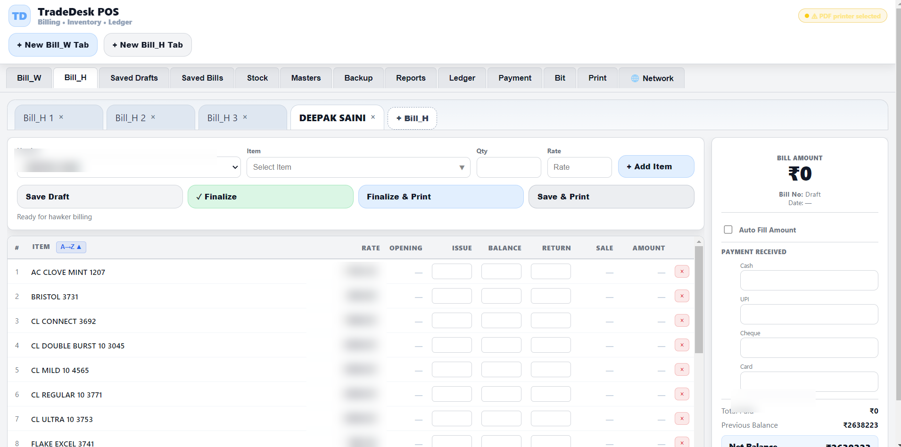

# TradeDesk POS — Wholesale Billing & Inventory

## Overview

TradeDesk POS is a desktop business application designed around wholesale and hawker billing workflows. The interface brings billing, inventory, masters, reports, ledger and payment operations into one application.

## Product workflows

- Separate wholesale (`Bill_W`) and hawker (`Bill_H`) billing flows.
- Multiple billing tabs and saved draft workflows.
- Bill finalization and print-oriented actions.
- Payment entry for cash, UPI, cheque and card.
- Stock and master-data navigation.
- Stock movement, sales, profit and godown reporting options.
- Ledger and payment workflows.
- Dashboard summaries for sales, bills generated, average bill value, collections and hawker issues.

## Product screenshots

The following screenshots show the dashboard and hawker billing interface. Sensitive values and identifying details have been selectively blurred; charts, layout and workflow controls remain visible.

The stock-report screenshot is also included in the repository, but it displays an empty result state (“No data found”) and is not presented as evidence of populated reporting output.

## Technical implementation

The project context identifies the desktop stack as Node.js, Express, Electron, SQLite and JavaScript, with PDF generation and thermal-printer integration.

The dashboard screenshot explicitly states that figures are computed from local SQLite records. The application also includes backup/restore and audit-related workflows in the project implementation context.

## Architecture (high level)

1. Electron desktop shell hosts the application.
2. The UI handles billing, stock, reports and account workflows.
3. The Node.js/Express backend coordinates application operations.
4. SQLite stores local business records for offline-capable operation.
5. Printing and PDF generation connect billing workflows to local output devices.

## Engineering considerations

- Keep bill creation and stock changes consistent.
- Preserve an auditable movement history rather than treating stock as a single editable number.
- Support offline local operation and predictable backup/restore.
- Keep printer-specific behavior separate from billing calculations.
- Avoid exposing customer, supplier or financial data in public screenshots.

## Verification boundaries

The supplied screenshots show the dashboard, hawker billing and stock-report interface. The dashboard contains populated financial figures and the billing screenshot exposes a party name and previous balance; these sensitive areas have been selectively blurred for public display.

The stock-report screenshot supplied for this portfolio displayed “No data found”; it should not be used as evidence of populated report output.

No public performance, uptime, customer-count or revenue claims are made here.
