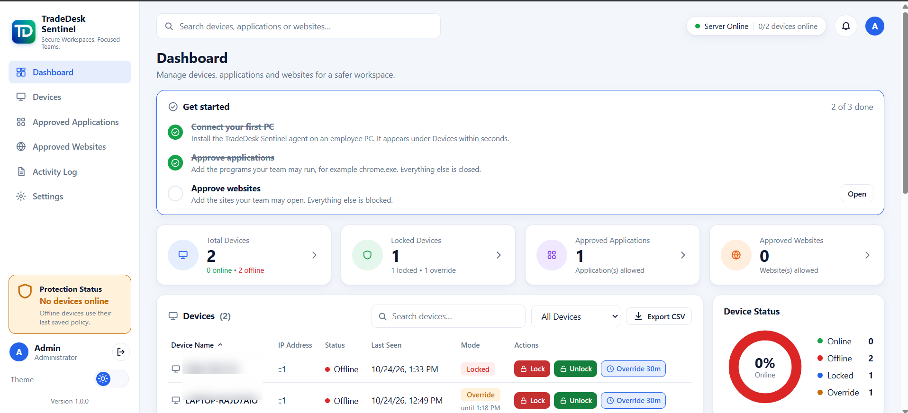
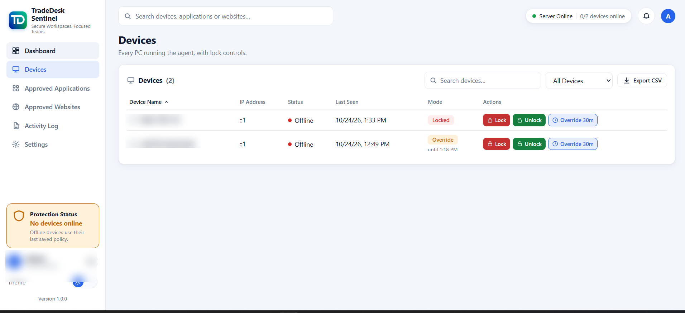

# TradeDesk Sentinel — Windows Workspace Control

## Overview

TradeDesk Sentinel is a Windows-focused workspace-control product with an administrator dashboard for managing enrolled devices, approved applications, approved websites and activity records.

The project context identifies a Node.js agent/server architecture with a local SQLite cache and Windows integration.

## Product screenshots

The screenshots below show the administrator dashboard and device-management interface. Device identifiers and other identifying details have been selectively obscured. The device screenshot shows two devices offline, so it demonstrates the management interface rather than successful live endpoint enforcement.

[View the activity log screenshot](../assets/screenshots/tradedesk-sentinel-activity-log.png).

## Product workflows visible in the supplied screenshots

- Device inventory with online/offline status and last-seen information.
- Administrative lock, unlock and temporary override controls.
- Approved application management.
- Approved website management.
- Activity log with event and date filters.
- CSV export controls.
- Server status and device protection indicators.
- Light/dark theme control in the interface.

## Technical direction

The project context identifies:
- Node.js agent and server components.
- SQLite local cache for agent-side state.
- Windows Registry integration and enforcement modules.
- Installer and service lifecycle handling.
- Licensing, TLS/authentication and recovery components.

## Architecture (high level)

1. Administrator uses the web dashboard.
2. The server stores device and policy state.
3. The Windows agent receives or applies policy and maintains local state.
4. Windows integration components enforce configured restrictions.
5. Activity events are surfaced in the administrator console.

## Verification boundaries

The supplied device screenshot shows two devices offline and zero online. The screenshots therefore demonstrate the administrative interface and controls, not successful live enforcement on connected endpoints.

The project context records 35 installer-logic tests passing, but Windows 10 Pro validation and deployment testing were still pending. Do not describe the product as fully production-validated or claim that all restrictions have been proven on supported Windows versions.

No production-scale performance, uptime or customer-outcome claims are made.
